# nng-kit

A plugin marketplace with the `lifecycle` idea-to-shipped skill chain, `delegate` for handing plan waves to headless coding CLIs while Claude Code gates and reviews, `exec-observe` for live status panes of those runs, and `relay` for cross-surface session handoffs. The `lifecycle` skills also run in Cursor, Devin, Antigravity (`agy`), and Windsurf; `relay` also runs in Cursor, Devin, and `agy`.

Source of truth is the `nng-kit/` folder of the private source repo; this repo is snapshot-synced by CI on each merge, so open changes there, not here. Notable changes live in [CHANGELOG.md](CHANGELOG.md).

## Lifecycle & `/conduct` flow

Every stage can be invoked standalone, or orchestrated end-to-end by `/conduct` with two human gates, deterministic plan locks (`plan-status.sh`), an optional in-session delegate loop, and an optional unattended worktree worker.

```mermaid
flowchart TB
  Start(["Idea, brainstorm,<br/>or docs/plans/*.md"]) --> Entry{"Standalone skill<br/>or /conduct?"}

  Entry -- "Standalone" --> S1
  Entry -- "/conduct" --> Router["Step 0–0.6: Route + Policy + Preflight<br/>tiers.sh policy · finish · delegate · plan · confirm<br/>default branch · foreign paths · ahead branch"]

  Router -. "free text / none" .-> S1
  Router -. "docs/brainstorms/*" .-> S2
  Router -. "plan (not-started)" .-> S3
  Router -. "lock --gate ok<br/>or resume (in-progress/partial/failed) + lock ok" .-> S4
  Router -. "resume (completed) + lock ok" .-> S5
  Router -. "lock exit 3 (plan changed)<br/>or plan handed off" .-> StopL(["Hard stop (no stage runs)"])

  subgraph Planning["Plan & Human Gates (top-plan)"]
    direction TB
    S1["Stage 1: /brainstorm<br/>Goal brief · feasibility · Decisions<br/>writes docs/brainstorms/**"]
    GateA{"Gate A (/conduct)<br/>Refine / Continue / Stop"}
    S2["Stage 2: /make-plan<br/>v2 Execution map · ## Dispatch<br/>rows --lint · stamp (plan_sha)"]
    S3["Stage 3: /critique plan<br/>top-critique read-only Task<br/>(skipped if Plan size: small)"]
    GateB{"Gate B — Hard Approval<br/>Approve / Refine / Abort<br/>approve stamps gate_b_sha"}

    S1 --> GateA
    GateA -- "Refine" --> S1
    GateA -- "Continue" --> S2
    S1 -. "scope already clear" .-> S2
    S2 --> S3 --> GateB
    GateB -- "Refine (/make-plan update)" --> S2
  end

  GateA -- "Stop" --> StopA(["Stop (brainstorm saved)"])
  GateB -- "Abort" --> StopB(["Stop (no code changes)"])
  GateB -- "Continue here" --> S4
  GateB -- "Fresh mid session<br/>(lock --gate)" --> S4
  GateB -- "Continue unattended<br/>(no delegate:* rows)" --> Unatt[["worktree.sh create (handoff_run)<br/>launch.sh print / headless<br/>mid worker: unattended=yes"]]
  Unatt --> S4

  subgraph ExecReview["Execute & Critique (feature branch unless finish=none)"]
    direction TB
    S4["Stage 4: /execute-plan<br/>wave subagents · delegate-verify.sh<br/>independent review (mid → top) · fingerprint"]
    Del[["delegate plugin (Claude Code)<br/>/delegate:execute-via-cursor / agy / devin<br/>/delegate:review · watched by /exec"]]
    S5["Stage 5: /critique change<br/>whole-branch diff · lean mid + verify gate<br/>closing top + security pass · Verification"]

    S4 <-->|"delegate=run: checkpoint commits + loop<br/>delegate=print: print Dispatch and downgrade"| Del
    S4 --> S5
  end

  S5 --> Down{"Downgrade check<br/>clean review, Verification ok,<br/>non-default branch?"}
  Down -- "Any failure / dirty /<br/>unattended stop" --> FinishNone["finish=none (downgraded)<br/>preserve tree and checkpoints<br/>unattended: status.sh stopped"]

  Down -- "Clean" --> S6["Stage 6: /conduct Finish<br/>none / commit / push (default) / pr<br/>unattended: relax.unattendedFinish (draft PR) + status.sh"]

  subgraph PostShip["Standalone Commit, PR, Review & Release"]
    direction LR
    Commit["/commit<br/>Conventional Commit"]
    Retro["/retro<br/>lessons · decisions"]
    PR["/gh-create-pr<br/>Distil & Drop gate · CI"]
    Addr["/gh-address-review<br/>triage · fix · reply · CI"]
    Rel["/gh-draft-release<br/>or /gh-tag-release"]

    Commit --> PR --> Addr --> Rel
    Commit -. "Distil & Drop" .-> Retro
  end

  FinishNone -. "manual finish" .-> Commit
  S6 -. "after finish=commit/push" .-> PR
  S6 -. "after finish=pr" .-> Addr
  S6 -. "optional" .-> Retro

  Relay[["Cross-cutting: /relay:save · pickup · check · discard<br/>session handoff across Claude Code, Cursor, Devin, agy & chat"]]

  style Planning fill:none,stroke:#6c8ebf,stroke-width:1.5px
  style ExecReview fill:none,stroke:#82b366,stroke-width:1.5px
  style PostShip fill:none,stroke:#9673a6,stroke-width:1.5px
  style GateA stroke:#d6b656,stroke-width:2px
  style GateB stroke:#d79b00,stroke-width:2.5px
  style Down stroke:#b85450,stroke-width:2px
  style Unatt stroke:#d79b00,stroke-width:1.5px
  style Del stroke:#6c8ebf,stroke-width:1.5px
  style Relay stroke:#9673a6,stroke-width:1.5px,stroke-dasharray: 5 3
```



Full stage contracts, overrides, unattended worker rules, guardrail policy, and deterministic script specs live in [LIFECYCLE.md](plugins/lifecycle/LIFECYCLE.md).

## Plugins

| Plugin | Version | What it is | Docs |
| --- | --- | --- | --- |
| `lifecycle` | 0.29.0 | Idea → shipped skill chain (`conduct` + 10 composable skills) | [LIFECYCLE.md](plugins/lifecycle/LIFECYCLE.md) |
| `delegate` | 0.22.0 | Hands plan waves to Cursor (`agent`), Antigravity (`agy`), or Devin (`devin`) CLIs while Claude Code gates and reviews | [delegate/README.md](plugins/delegate/README.md) |
| `exec-observe` | 0.6.0 | Live `/exec` pane, status line, and `/exec history` for `delegate` runs (never in model context) | [exec-observe/README.md](plugins/exec-observe/README.md) |
| `relay` | 0.6.0 | Cross-surface handoff (`save` / `pickup` / `check` / `discard` + `SessionStart` hook) | [relay/README.md](plugins/relay/README.md) |

### `lifecycle` skills

| Skill | Does | Writes to | Commits / pushes? |
| --- | --- | --- | --- |
| `conduct` | Orchestrates Stages 1–6 with Gate A & Gate B (`gate_b_sha`), up-front finish mode, optional `delegate=run` checkpoint loop, and **Continue unattended** (`mid` worker in a sibling worktree via `worktree.sh` / `launch.sh` / `status.sh`) | Brainstorms, plans, working tree; git branch/commits/push/PR; unattended: sibling worktree + `.claude/tmp/conduct-<run-id>.json` | Per finish mode (`push`, `pr`, `commit`, `none`) + `delegate=run` checkpoints; unattended finishes per `relax.unattendedFinish` (`pr` opens draft PR); never to default branch |
| `brainstorm` | Goal brief, feasibility read, roadmap, **Decisions** + `/make-plan` handoff prompt | `docs/brainstorms/**` | Never |
| `make-plan` | Structured plan with Execution map v2, `## Dispatch`, lint + `plan_sha` stamp | `docs/plans/**` | Never |
| `critique` | Independent review of a plan (`top-critique`) or change (`--depth quick\|standard\|deep`, mid verifier gate + closing top + security pass) | Plan file or working tree | Never |
| `execute-plan` | Runs v2 map waves through subagents, mid + top independent review, `plan-status.sh` audit, `delegate-verify.sh` Verification | Working tree + plan audit metadata | Never by default (standalone local auto-commit only with opt-in `relax.executePlanCommit`) |
| `commit` | Conventional Commit (optional version / `CHANGELOG.md` bump) after approval | Local git history | Commits only |
| `retro` | 1–3 one-line lessons from a plan's runs via `lessons.sh` (capped), plus a decision record (ADR) naming the plan's `refs/plan-archive/<slug>` | `docs/lessons.md`, `docs/decisions/<slug>.md` | Never |
| `gh-create-pr` | Planning-artifacts gate (Distil & Drop / Drop / Keep plans, Keep/Drop relay files; dropped plans archived to `refs/plan-archive/<slug>`), branch, optional commit compaction, push, PR via `gh`, CI watch | Remote branch + PR | After approval (separate approvals for pushing archive refs, compaction, and `--force-with-lease` on a pushed branch) |
| `gh-address-review` | Triage PR feedback & failing CI, fix, commit, push, batch-approved replies, opt-in thread resolve, CI re-watch | Working tree, remote branch + PR replies | After approval |
| `gh-draft-release` | Draft GitHub Release with generated notes (no tag/publish) | Draft release | After approval |
| `gh-tag-release` | Date `CHANGELOG.md` and push a release tag to trigger publish CI | Tag + publish CI | After approval |

Bookkeeping that must not depend on model prose runs through deterministic bash scripts (`plan-status.sh`, `delegate-verify.sh`, `tiers.sh`, `delegate-skill.sh`, `worktree.sh`, `launch.sh`, `conduct/scripts/status.sh`, `pr-artifacts.sh`, `pr-compact.sh`, `git-preflight.sh`, `pr-feedback.sh`, `lessons.sh`). `execute-plan` ships synced copies of `plan-status.sh`, `delegate-verify.sh`, `tiers.sh`, and `tiers.json` so lifecycle-only installs work without `delegate`.

## Install

### Quick start (Claude Code)

```bash
claude plugin marketplace add nigelng/nng-kit
claude plugin install lifecycle@nng-kit
claude plugin install relay@nng-kit
# Optional, local only (Claude Code):
claude plugin install delegate@nng-kit
claude plugin install exec-observe@nng-kit
```

Plugin skills are namespaced: `/lifecycle:conduct`, `/lifecycle:make-plan`, `/relay:save`, `/delegate:execute-via-cursor`, …

### Other surfaces

| Surface | Plugins / Skills | How to install |
| --- | --- | --- |
| **Claude Code (per-repo / Cloud)** | `lifecycle`, `relay` | Add `extraKnownMarketplaces` + `enabledPlugins` in `.claude/settings.json` |
| **Devin** | `lifecycle`, `relay` | Web app (**Customize → Plugins** → `nigelng/nng-kit#plugins/lifecycle` & `#plugins/relay`) + symlink `host-profiles/devin/kit-*.md` into `~/.config/devin/agents/` |
| **Cursor** | `lifecycle`, `relay` | Import `https://github.com/nigelng/nng-kit` via **Customize → From GitHub Repository** (personal) or **Team Marketplaces**, or vendor with `vendor-skills.sh` |
| **Antigravity (`agy`)** | `lifecycle`, `relay` | `agy plugin install <nng-kit>/plugins/lifecycle` (and `plugins/relay`) |
| **Windsurf / plain skills** | `lifecycle` | Symlink `plugins/lifecycle/skills/<name>/` into `~/.agents/skills/` and tool skills dir |

Full step-by-step instructions (including Devin profiles, Cursor Cloud Agents & vendoring CI action, `delegate` CLI prerequisites, and `relay` remote storage) are in [plugins/lifecycle/INSTALL.md](plugins/lifecycle/INSTALL.md), [plugins/delegate/README.md](plugins/delegate/README.md#prerequisites), and [plugins/relay/README.md](plugins/relay/README.md).

## Configuration

User-level configuration lives outside the repository in two optional files:

- **`~/.config/nng-kit/tiers.json`** (respects `$XDG_CONFIG_HOME`, or override via `$NNG_KIT_TIERS`) — partial JSON deep-merged over the shipped registry `plugins/delegate/scripts/tiers.json` (`objects` merge, `arrays` replace). Set only what you change. `.conduct` settings require a **regular file outside any git repository or worktree** (paths resolving inside a repo, including symlinks, are ignored as `ignored:in-repo`).
- **`~/.config/relay/env`** (or `env` in host `settings.json`) — optional `RELAY_BACKEND` / `RELAY_ROOT` remote mirror config for `relay`.

### Model tiers & registry overrides

Skills resolve models by role rather than hardcoding model slugs. Shipped pins live in `plugins/delegate/scripts/tiers.json` and are rendered in [model-tiers.md](plugins/lifecycle/model-tiers.md); full schema and resolution details are in [tiers.example.json](plugins/lifecycle/tiers.example.json) and [delegate/README.md#tool-registry](plugins/delegate/README.md#tool-registry).

| Tier | Used for | Fallback |
| --- | --- | --- |
| `top-plan` | `/brainstorm`, `/make-plan`, `/critique plan` sessions | Next tool in `planningOrder` via `/relay:save` + `/relay:pickup` |
| `top-review` | `top` map rows, batch/final reviews, `/critique` closing pass | `top@devin-fusion` when Devin is enabled and not host; else stop and ask |
| `top-critique` | Optional cross-family `/critique plan` review subagent | Falls back to `top-review` |
| `execute` | `execute` map rows and default `delegate:*` launches | Falls back to `mid` (`role: "implement"`) |
| `mid` | `/execute-plan` orchestrator (v2 maps), `mid` implement and review passes (`role`: `"implement"` \| `"review"`) | None (exits `3` if exhausted) |
| `low` | `low` map rows | Falls back to `mid` (same `role`) |

Key override keys in `~/.config/nng-kit/tiers.json`:

- `host` — default host tool (`"claude-code"` shipped; `"cursor"`, `"devin"`, or `"agy"`).
- `planningOrder` — fallback order across tools when `top-plan` is exhausted (`["claude-code", "cursor", "devin", "agy"]`).
- `tools.<id>.enabled` — enable or disable a tool (`true` / `false`).
- `tools.<id>.until` and row `until` (`YYYY-MM-DD`) — expiry date; expired entries are skipped and logged.
- `tools.<id>.tiers.<tier>` — ordered pin array of `{model, role?, until?, note?}` (`role` is `"implement"` or `"review"`).
- `tools.<id>.defaultReviewRunner` / `reviewRunners` — default and available `top@<name>` review runners.
- `tools.<id>.authEnv` — extra env var names passed through the delegate clean-env allowlist.

Example partial `~/.config/nng-kit/tiers.json` (omit `host` and `tools` to keep shipped pins live; omit `notify` when unused — do **not** set `"notify": null`):

```json
{
  "conduct": {
    "launcher": "headless",
    "defaults": {
      "finish": "push",
      "delegate": "print",
      "plan": "keep",
      "confirm": "no",
      "continue": "fresh"
    },
    "headless": {
      "timeoutMinutes": 120,
      "permissionMode": "auto"
    },
    "relax": {
      "skipChoicePrompt": false,
      "reuseAheadBranch": false,
      "executePlanCommit": false,
      "unattendedFinish": ["pr"]
    }
  }
}
```

Verify merged settings and resolved pins (lifecycle-only installs use `plugins/lifecycle/skills/execute-plan/scripts/tiers.sh`):

```bash
bash plugins/delegate/scripts/tiers.sh validate
bash plugins/delegate/scripts/tiers.sh resolve <tool> <tier> [--role implement|review]
bash plugins/delegate/scripts/tiers.sh policy
bash plugins/delegate/scripts/tiers.sh headless
```

Advisor: not configured by the kit. In Claude Code set `advisorModel` in `settings.json`; in Cursor install the Advisor plugin and run `/advisor <slug>` per project.

### Guardrail policy (`.conduct`)

User-only `/conduct` and standalone `/execute-plan` policy lives under `.conduct` in `~/.config/nng-kit/tiers.json` (`CLI args > .conduct.defaults > skill default`; invalid schemas exit `2` and callers fall back to strict defaults):

| Key | Allowed values | Default | Effect |
| --- | --- | --- | --- |
| `conduct.launcher` | `"print"` \| `"headless"` | `"print"` | Unattended worker launcher; `"headless"` requires a matching probe marker (`launch.sh probe headless --model <mid-model>` → `~/.local/state/nng-kit/headless-probe.json`) |
| `conduct.defaults.finish` | `"push"` \| `"pr"` \| `"commit"` \| `"none"` | `"push"` | Default Stage 6 finish mode |
| `conduct.defaults.delegate` | `"print"` \| `"run"` | `"print"` | Default `delegate:*` handling on Claude Code |
| `conduct.defaults.plan` | `"keep"` \| `"drop"` | `"keep"` | Default Stage 6 plan handling |
| `conduct.defaults.confirm` | `"no"` \| `"yes"` | `"no"` | Ask before Stage 6 commit/PR |
| `conduct.defaults.continue` | `"fresh"` \| `"here"` \| `"unattended"` | `"fresh"` | Default Gate B continuation mode |
| `conduct.headless.timeoutMinutes` | integer `1`–`1440` | `120` | Headless worker timeout before TERM/KILL |
| `conduct.headless.permissionMode` | `"auto"` \| `"acceptEdits"` \| `"default"` | `"auto"` | Claude permission mode for headless workers |
| `conduct.headless.notify` | non-empty argv array (`notify[0]` absolute executable path) | omitted | Detached hook invoked when a worker records status (status JSON path appended as final arg) |
| `conduct.relax.skipChoicePrompt` | `false` \| `true` | `false` | Skip `/conduct` Step 0.5 prompts already covered by `defaults` |
| `conduct.relax.reuseAheadBranch` | `false` \| `true` | `false` | Reuse an ahead feature branch in Step 0.6 without prompting (not applied to unattended workers) |
| `conduct.relax.executePlanCommit` | `false` \| `true` | `false` | Auto-commit locally on a non-default branch after a clean standalone `/execute-plan` (never pushes) |
| `conduct.relax.unattendedFinish` | non-empty subset of `["pr", "push", "commit"]` | `["pr"]` | Finish modes allowed for unattended workers |

Hard safety rules (no commits/pushes to default branch, no force-push/`--no-verify`/amend, no secrets/brainstorms/foreign paths, no Gate B/review/verification bypass) cannot be relaxed. Details: [LIFECYCLE.md#guardrail-policy](plugins/lifecycle/LIFECYCLE.md#guardrail-policy).

### Enable or disable a tool

All four tools (`claude-code`, `cursor`, `devin`, `agy`) ship enabled (`enabled: true`; `cursor`, `devin`, and `agy` ship with `delegate: true`). Disable any tool you do not use on a host (`cursor`, `devin`, or `agy`; keep `claude-code` enabled) in `~/.config/nng-kit/tiers.json`:

```bash
mkdir -p ~/.config/nng-kit
[ -f ~/.config/nng-kit/tiers.json ] || printf '{}\n' >~/.config/nng-kit/tiers.json
jq '.tools.<id>.enabled = false' ~/.config/nng-kit/tiers.json >~/.config/nng-kit/tiers.json.tmp \
  && mv ~/.config/nng-kit/tiers.json.tmp ~/.config/nng-kit/tiers.json
```

Re-enable by removing the key (`jq 'del(.tools.<id>.enabled)'`) or setting it to `true`. Verify live enablement and resolved pins with `tiers.sh` (generated `model-tiers.md` and Devin `kit-*.md` profiles ignore runtime overrides):

```bash
bash plugins/delegate/scripts/tiers.sh tools
bash plugins/delegate/scripts/tiers.sh resolve <id> execute
```

Lifecycle-only installs have no `delegate` plugin: use `plugins/lifecycle/skills/execute-plan/scripts/tiers.sh` instead.

Disabled tools exit `3` (`REFUSE:` on stderr) across `tiers.sh resolve`, `plan-status.sh rows` / `rows --lint` (non-`done` rows), `delegate-launch.sh`, and `delegate-review-launch.sh run`. Status writers (`start`, `batch`, `terminal`, `review`), `tiers.sh delegates`, and review guard/verdict helpers remain open so in-flight runs can finish.

### Environment variables

| Variable | Values / default | Effect |
| --- | --- | --- |
| `NNG_KIT_TIERS` | path (default `${XDG_CONFIG_HOME:-~/.config}/nng-kit/tiers.json`) | Override the `tiers.json` override file path |
| `NNG_KIT_HEADLESS_PERMISSION_MODE` | `auto` \| `acceptEdits` \| `default` | Override `.conduct.headless.permissionMode` for headless workers |
| `NNG_KIT_HEADLESS_TIMEOUT_SECONDS` | positive integer | Override `.conduct.headless.timeoutMinutes` in seconds |
| `DELEGATE_SANDBOX` | `on` (default) \| `off` | `off` restores Cursor `--force` without `--sandbox` when tasks need network or outside-workspace writes (`cursor` only) |
| `DELEGATE_ENV_ALLOW` | comma-separated var names | Add variables (e.g. `ANTHROPIC_API_KEY`) to the delegate clean-env allowlist |
| `DELEGATE_MCP` | `1` (default unset) | Re-enable configured MCP servers on `top@claude-headless` only |
| `DELEGATE_TIMEOUT` / `DELEGATE_REVIEW_TIMEOUT` | `<n>[smh]` (defaults `90m` / `30m`) | Timeout ceilings for delegate execute and external review runs |
| `DELEGATE_VERIFY_TIMEOUT` | integer seconds (default `900`) | Timeout ceiling for `delegate-verify.sh` commands |
| `AGY_CLI_DISABLE_AUTO_UPDATE` | `true` | Keep Homebrew as the sole updater for `agy` (passed through delegate clean env) |
| `RELAY_BACKEND` / `RELAY_ROOT` | `dropbox` / path (unset = repo-only) | Enable remote handoff mirroring (process env or `~/.config/relay/env`) |

### Subagent hosts

`/execute-plan` and `/critique` spawn subagents per [execute-plan/hosts.md](plugins/lifecycle/skills/execute-plan/hosts.md):

- **Claude Code:** `Task` with tier model alias (`opus`, `sonnet`, `haiku`, `fable`).
- **Cursor:** `Task` with the resolved model slug.
- **Devin:** `run_subagent` with `kit-<role>` profiles (read-only profiles have no shell, so the session passes diff/lint files).
- **Antigravity (`agy`):** `invoke_subagent` (`Model: "inherit"`) when the pin matches the session model, else a pinned `swarm` worker.

Any other host or unpinnable model stops before delegating (except Devin `/critique plan` in-session fallback). `delegate` skills require Claude Code.

## Portability & maintainers

- `SKILL.md` files use only relative sibling links (one level deep, or `../<skill>/<file>` within `plugins/lifecycle/skills/`) and no `${CLAUDE_PLUGIN_ROOT}` or plugin-only syntax.
- Source-repo maintainers sync scripts with `scripts/sync-kit-scripts.sh`, regenerate `model-tiers.md` and Devin profiles with `scripts/sync-model-tiers.sh`, and verify budgets with `scripts/skill-budget.sh` against `scripts/nng-kit-skill-budgets.tsv`.
